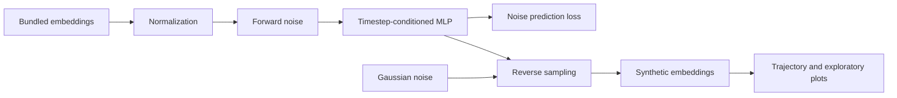

# SpeakerDiff

**Diffusion-based speaker embedding generation for speech privacy research.**

SpeakerDiff is an experimental PyTorch implementation of denoising diffusion probabilistic models (DDPMs) for generating synthetic speaker embeddings. It explores how a generative model can approximate a distribution of speaker representations as a building block for future voice anonymization systems.

**Project status: research prototype.** The current implementation generates embedding vectors, not speech waveforms. Speaker anonymization, intelligibility preservation and resistance to speaker verification attacks have not yet been demonstrated.

## Contents

- [Current capabilities](#current-capabilities)
- [Architecture](#architecture)
- [Quickstart](#quickstart)
- [Datasets](#datasets)
- [Outputs and evaluation](#outputs-and-evaluation)
- [Repository structure](#repository-structure)
- [Roadmap](#roadmap)
- [Responsible use and licensing](#responsible-use-and-licensing)
- [References](#references)

## Current capabilities

| Capability | Status |
| --- | --- |
| Timestep-conditioned MLP noise estimator | Used by the current training script |
| DDPM-style forward noise and reverse sampling | Experimental implementation; mathematical validation pending |
| 64-dimensional embedding training | Default workflow |
| Sampling trajectories and exploratory plots | Implemented |
| 1D U-Net | Legacy experimental architecture; not used by default |
| Reusable model checkpoints, independent inference and DDIM | Planned |
| End-to-end voice anonymization and privacy evaluation | Planned |

## Architecture

The current training workflow is:



The forward process adds Gaussian noise to an embedding according to a variance schedule. A timestep-conditioned denoiser learns to estimate this noise. Reverse sampling starts from Gaussian noise and iteratively applies the learned denoiser.


The active model is defined in [code/model.py](code/model.py). The legacy U-Net diagram is available [here](figures/Unet.drawio.png); that architecture needs shape and timestep-conditioning validation before use as a diffusion baseline.

## Quickstart

### Legacy environment

The repository currently uses historical dependency pins, including PyTorch 1.12.1. Python 3.8 was the original documented environment; it is end-of-life. Use an isolated environment for reproduction, not a production or internet-facing service. Modern supported dependencies are planned.

From a trusted checkout, and only after verifying the bundled serialized dataset is trusted and permitted for your use:

```bash
git clone https://github.com/Akshat4112/speaker-diffusion.git
cd speaker-diffusion
python3.8 -m venv .venv
source .venv/bin/activate
python -m pip install -r requirements.txt
```

The legacy training script uses pickle-backed PyTorch loading, so never substitute untrusted .pt files. Dependency compatibility and a fresh-environment run must be verified before relying on this setup.

### Small CPU training run

```bash
python code/main.py --epochs 2 --datapoints 64 --output-dir /tmp/speakerdiff-smoke
```

This source-defined workflow uses the 64D dataset, a conditional MLP, 100 diffusion steps and disabled Weights & Biases logging by default. It is a proposed smoke check, not a published benchmark or a newly verified run.

| Argument | Default | Meaning |
| --- | --- | --- |
| `--epochs` | 1000 | Number of training epochs |
| `--datapoints` | 5000 | Maximum number of embeddings; must exceed 20 |
| `--output-dir` | Repository root | Destination for generated artifacts |

Use a separate output directory to avoid modifying tracked historical figures. The script runs on CPU and uses a noninteractive plotting backend. Remote logging requires explicitly configuring W&B; do not upload embeddings or derived data unless permitted.

## Datasets

The original project attributes its bundled embeddings to LibriSpeech. Extraction procedure, speaker labels, counts and redistribution rights still require verification.

| File | Current understanding |
| --- | --- |
| [embedding_vectors_as_list64.pt](dataset/embedding_vectors_as_list64.pt) | Default training input; script validates 64 features |
| [embedding_vectors_as_list128.pt](dataset/embedding_vectors_as_list128.pt) | Identical Git blob to the 64D file; not an independent 128D dataset |
| [704dim_embeds.pt](dataset/704dim_embeds.pt) | Historical asset; dimensions and provenance pending audit |

The current script selects a prefix of the dataset. It does not implement a held-out or speaker-disjoint evaluation protocol.

## Outputs and evaluation

The training script writes:

- `GeneratedEmbeddings/64_dimension_embedding_datapoints.pt`: generated sampling trajectory, **not** reusable model weights.
- `figures/`: before/after scatter plots and an exploratory overlay.
- Console output: loss, descriptive statistics and pairwise cosine similarity.

Historical figures are retained for transparency, but current real and generated t-SNE projections are fitted independently and therefore cannot be interpreted as a shared embedding space. Generated vectors are also normalized separately. Neither the plots nor the descriptive statistics establish voice privacy or distributional fidelity.

Future evaluation will use shared projections, held-out data, statistical baselines and reproducible metrics. End-to-end evaluation will require compatible speech synthesis, independent speaker verification (EER), recognition (WER) and explicit attacker assumptions.

## Repository structure

```text
speaker-diffusion/
├── code/
│   ├── main.py           # Training and sample generation
│   ├── model.py          # Conditional MLP and experimental U-Net
│   ├── utils.py          # Schedules, diffusion and loss utilities
│   ├── ema.py            # Exponential moving average helper
│   └── dataNormalize.py  # Embedding normalization
├── dataset/              # Historical serialized embeddings
├── figures/              # Illustrations and experimental plots
├── references/           # Historical research material
└── requirements.txt      # Legacy dependency pins
```

## Roadmap

| Milestone | Planned outcome |
| --- | --- |
| v0.1 | Documentation, repository hygiene, packaging, licensing and CI |
| v0.2 | Dataset audit, safe loading and reproducible splits |
| v0.3 | Validated diffusion mathematics, EMA, DDIM and checkpoints |
| v0.4 | Inference SDK, baseline models and research benchmarks |
| v0.5 | End-to-end speech anonymization and privacy evaluation |
| v1.0 | Validated demo, documentation, model cards and release |

These are development targets, not released versions. Current known limitations include final-step sampling noise, an unvalidated terminal noise schedule, unused EMA weights during final sampling, no independent inference checkpoint and no reproducible training seed.

## Responsible use and licensing

This repository is intended for research on privacy-preserving speech processing. Synthetic embeddings are not proof of anonymization. Do not use the prototype to make privacy guarantees or impersonate individuals.

A code license and dataset/model redistribution terms have not yet been established in the repository. Public availability does not establish permission to redistribute or reuse assets. Confirm applicable rights and consent before processing or distributing speech, embeddings or model artifacts.

## References

1. Ho, Jain and Abbeel. [Denoising Diffusion Probabilistic Models](https://arxiv.org/abs/2006.11239), 2020.
2. Song, Meng and Ermon. [Denoising Diffusion Implicit Models](https://arxiv.org/abs/2010.02502), 2021.
3. Dhariwal and Nichol. [Diffusion Models Beat GANs on Image Synthesis](https://arxiv.org/abs/2105.05233), 2021.
